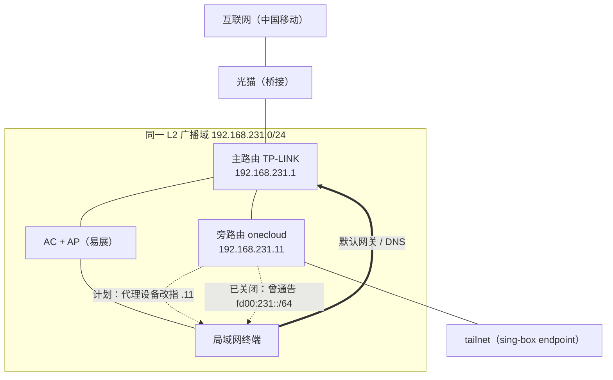

# 家庭网络架构（实测，2026-10-29）

## 一、架构图

### 链路关系

| 链路 | 关系 | 说明 |
|---|---|---|
| 光猫 ↔ 主路由 | PPPoE | 光猫桥接，主路由拨号；主路由已拿到移动 IPv6 前缀 |
| 主路由 ↔ AC+AP ↔ 终端 | 纯二层 | AP 不提供网关与 DNS |
| 主路由 ↔ 旁路由 | 同段旁挂 | 旁路由不做默认网关 |
| 终端 → 主路由 | IPv4/IPv6 默认出口 | 网关与 DNS 均为 `192.168.231.1`；IPv6 下一跳 `fe80::828f…` |
| 终端 → 旁路由（计划） | 仅代理设备 | dnsmasq 按 `tag:proxy_devices` 改发 `option 3/6 = 192.168.231.11` |
| 旁路由 ↔ tailnet | sing-box tailscale endpoint | 子网路由 `192.168.231.0/24` 已宣告并经管理台批准（2026-10-31）；对端入站可达 LAN（实测 sukean → .148:22000） |
| 旁路由 → 终端 | 多余 RA（已关闭） | 曾通告 `fd00:231::/64` 与第二条默认路由（第五节故障）；2026-10-31 注释 dnsmasq RA 三行后停发，90s 抓包确认 |

### 终端在册（旁路由 DHCP 租约，实测）

| 主机名 | IPv4 | MAC | 备注 |
|---|---|---|---|
| m4000q | 192.168.231.148 | 84-7B-57-21-B8-B2 | 本机 Windows：Wi-Fi 6 → 网桥 → Hyper-V 外部交换机 |
| MIS-AL00 | 192.168.231.163 | CC-B0-A8-DF-55-20 | 华为设备，随机 MAC |
| OPPO-Reno3-Pro-5G | 192.168.231.120 | 6E-5A-59-9C-CD-11 | 随机 MAC |
| midea_ac_1363 | 192.168.231.178 | BC-89-F8-C1-E4-AE | 美的空调 |
| Bouffalolab_BL602-5262ad | 192.168.231.112 | 7C-B9-4C-52-62-AD | IoT |
| 无名 | 192.168.231.117 | 68-77-24-8D-2D-BB | 认定为 AP；已静态绑定 `192.168.231.2` |
| oec | 192.168.231.99 | DA-43-B1-F8-F7-78 | 静态租约 |
| woniu | 192.168.231.100 | 00-E2-69-13-C0-64 | 静态租约；本次无租约（关机），knockd WoL 目标 |

## 二、主路由 TP-LINK（192.168.231.1）

| 项目 | 实测值 |
|---|---|
| 角色 | PPPoE 拨号、IPv4 默认网关、IPv6 唯一应当通告 RA 的设备 |
| LAN IPv4 | 192.168.231.1/24 |
| LAN MAC | 80-8F-1D-25-D7-AE |
| 链路本地 | fe80::828f:1dff:fe25:d7ae |
| 通告前缀 | 2409:8a28:4e5:3d00::/64 [onlink,auto]，valid 86400 / pref 14400 |
| RDNSS | 2409:8a28:4e5:3d00:828f:1dff:fe25:d7ae |
| 出口公网 | IPv4 `39.182.8.9`、IPv6 `2409:8a28:4e5:3d00:…`，均归属浙江杭州移动（`myip.ipip.net` 实测）；未与主路由 WAN 显示值比对，不能判定 IPv4 是否独占 |
| 管理页 | http://tplogin.cn （旁路由 dnsmasq 有 `address=/tplogin.cn/192.168.231.1`） |

设置要点

- WAN：光猫桥接 + 主路由 PPPoE 拨号；IPv6 已拿到移动前缀，状态健康。
- 运营商是中国移动（`2409:8000::/20` 归移动，`2408:8000::/20` 才是联通）。
- **前缀会变**：实测 2026-10-29 通告 `2409:8a28:4e5:2ef0::/64`，次日已变为 `…:3d00::/64`（/64 整段换掉，不是子网重编）。因此任何配置都不要写死 GUA，匹配键一律用 IPv4 地址或链路本地地址。
- DHCP 服务：关闭，由旁路由接管（旁路由 `dhcp-authoritative`，下发 `option 3/6 = 192.168.231.1`）。
- IPv6：保持"无状态/SLAAC + 主路由通告 RA"，当前实际通告的是 2409:8a28:4e5:3d00::/64。
- IPv6 RA 唯一来源就是它：旁路由侧 RA 已于 2026-10-31 关闭，全网段只有主路由通告。

## 三、旁路由 onecloud（192.168.231.11）

| 项目 | 实测值 |
|---|---|
| 设备 | OneCloud（Amlogic meson8b，armv7l），Armbian 26.8.3 trixie，kernel 6.12.28-current-meson |
| 登录 | `ssh root@192.168.231.11`（`~/.ssh/config` 中别名 `tailscale`，key `~/.ssh/ed25519`） |
| eth0 IPv4 | 192.168.231.11/24 |
| eth0 MAC | f6:4b:57:a2:ed:1c（`/etc/netplan/20-eth-fixed-mac.yaml` 固定，因此 fe80 地址稳定） |
| eth0 IPv6 | GUA 2409:8a28:4e5:3d00:f44b:57ff:fea2:ed1c/64（SLAAC，由 networkd 用户态收 RA，路由 `proto ra metric 1024`）；静态 ULA fd00:231::1/64；LLA fe80::f44b:57ff:fea2:ed1c |
| IPv6 学习 | `/etc/netplan/armbian.yaml`：`dhcp6: false`（不用 DHCPv6-PD），`eth0.accept_ra=0`（交给 systemd-networkd） |
| 转发 | `net.ipv4.ip_forward=1`，`net.ipv6.conf.all.forwarding=1`（`/etc/sysctl.d/99-forwarding.conf`，2026-10-31 由 99-tailscale.conf 改名，sysctl 已重载） |
| 防火墙 | 空规则集（2026-10-31）：ts-\* 规则与 netfilter-persistent 已随 tailscale 清理一并移除，无持久化 ip(6)tables、无 nftables 规则集；FORWARD 策略 ACCEPT |
| sing-box tailscale endpoint | active/enabled；新节点 NodeID `nAfhqG1tt221CNTRL`（auth key 注册，2026-10-31，旧节点 .116 已随 tailscaled 移除）；`advertise_routes=["192.168.231.0/24"]`、`accept_routes=true` 已批准；tun-in 栈 **gvisor**（mixed/system 栈在本机吞掉本机出站 TCP，已实测确认并绕开）；state 在 `/var/lib/sing-box/ts` |
| DHCP 池 | 192.168.231.101–200/255.255.255.0/12h，`dhcp-authoritative`，`domain=lan`、`expand-hosts`、`dhcp-fqdn` |
| 静态租约 | woniu 192.168.231.100（00:E2:69:13:C0:64）；oec 192.168.231.99（DA:43:B1:F8:F7:78）；AP 192.168.231.2（68-77-24-8D-2D-BB，2026-10-31 新增） |
| DNS | :53，上游 223.5.5.5、119.29.29.29、2409:8028:2000::1111、2409:8028:2000::2222；`listen-address=192.168.231.11,127.0.0.1`；`/etc/resolv.conf` → `nameserver 127.0.0.1`；尾网段域名经 sing-box `taildns` 解析（dnsmasq 转发 → tun-in → hijack-dns，实测 `sukean` → 100.123.38.36） |
| 下发给普通客户端 | `option 3 = 192.168.231.1`、`option 6 = 192.168.231.1`、`option 138 = 192.168.231.1`、`option 60 = TP-LINK`（即默认全部直连主路由） |
| 代理设备标记 | `tag:proxy_devices` → `option:router/dns-server = 192.168.231.11`；当前唯一绑定该 tag 的 `dhcp-host` 行是注释状态，集合为空 |
| IPv6 RA | 已关闭（2026-10-31）：`enable-ra`、`dhcp-range=::,constructor:eth0,ra-only,slaac,64,1d`、`dhcp-option=eth0,option6:dns-server,fd00:231::1` 三行已注释；备份在 `/etc/dnsmasq.conf.d-ra-backup/` |
| 其他服务 | sshd active；cron、rsyslog、unattended-upgrades、systemd-resolved/timesyncd、armbian-* 一组 enabled（systemd-resolved 无 :53 监听，:53 由 dnsmasq 独占）；knockd active（端口序列 51002,58004,54781 → `wakeonlan 00:E2:69:13:C0:64`）；NetworkManager 未安装 |

设置要点（目标态）

1. IPv6 不由旁路由通告（已完成：RA 三行注释，2026-10-31），RA 与 RDNSS 全部交给主路由；脚本存档 `ipv6-fix/onecloud-dnsmasq-ra.sh`。
2. 只由 dnsmasq + sing-box 两个软件承担分流（已落地 2026-10-31，tailscaled 已 purge）：dnsmasq 负责"哪些设备走旁路由"，sing-box 负责转发；IPv6 保持直连不进隧道（RA 无法按设备区分）。入站形态 **TUN 先行**（`tun-in` auto_route，栈 gvisor），redirect `lan-redir:7892` 留作回退；tun-in 只配了 IPv4 地址，与"IPv6 直连"天然一致。
3. LAN→尾网段由 sing-box 的 tailscale endpoint 承担（`100.64.0.0/10 + fd7a::/48 → tailnet`，NAT 层搞定回程，无需 SNAT），出站实测通；`advertise_routes=192.168.231.0/24` 已批准，tailnet 对端入站可达 LAN（实测 sukean → .148:22000）。

## 四、旁路由已安装软件

| 软件 | 版本 | 安装方式 | 状态 | 位置 / 备注 |
|---|---|---|---|---|
| dnsmasq | 2.91-1+deb13u2 | apt | active / enabled | `/etc/dnsmasq.conf`，DHCP + DNS；RA 三行已于 2026-10-31 注释关闭，新增 `dhcp-host=68-77-24-8D-2D-BB,192.168.231.2`（AP 静态绑定） |
| tailscale / tailscaled | 1.104.2（含 tailscale-archive-keyring 1.35.181） | apt（官方源） | **已 purge（2026-10-31）**，职责由 sing-box tailscale endpoint 接管 | 旧节点 `onecloud.hale-city.ts.net`（100.93.202.116）随 purge 失效；新节点见第三节 endpoint 行 |
| sing-box | 1.14.4（armhf deb，dpkg 状态 `hi` 已 hold） | apt/deb | **active / enabled**（2026-10-31 启用） | unit `/usr/lib/systemd/system/sing-box.service`（User=sing-box，CAP_NET_ADMIN/RAW/NET_BIND_SERVICE/SYS_PTRACE，`-D /var/lib/sing-box -C /etc/sing-box`）；`/etc/sing-box/config.json`（600 root；auth key 已写入并消费，勿提交 git）；tailscale endpoint（state `/var/lib/sing-box/ts`）+ tun-in（gvisor）+ lan-redir:7892 并存；启动引导依赖直连 UDP 解析器 `boot=223.5.5.5`（`local` 链在旧 MagicDNS 残留时死锁）；升级方式：sagernet 源在板上拉不动（后端 403），本机下载 armhf deb、MD5 对过 apt 元数据后 scp + `dpkg -i` |
| systemd-networkd + netplan | 随 Armbian | — | active / enabled | `/etc/netplan/armbian.yaml`、`/etc/netplan/20-eth-fixed-mac.yaml` |
| knockd | 0.8-2+b4 | apt | active / enabled | WoL 触发（woniu） |
| systemd-resolved / systemd-timesyncd | 随 systemd | apt | enabled | resolved 存在但无 :53 监听（dnsmasq 独占）；timesyncd 对时 pool.ntp.org 实测同步正常（chrony 经评估无增益，不装） |
| armbian-config / armbian-firmware / bsp-cli-onecloud | 26.8.x | Armbian 镜像 | — | 板级工具 |
| tcpdump | 4.99.5 | apt | — | 诊断用 |

2026-10-31 裁剪记录：purge 了 tailscale、tailscale-archive-keyring、wireguard-tools（与 tailscale 无依赖关系，纯手工装）、wpasupplicant、iw、wireless-regdb（板上无无线接口，死重）、netfilter-persistent（连带 iptables-persistent）；`/var/lib/tailscale` 已删除；迁移备份在板上 `/root/migration-backup-20261031/`。

## 五、已修复的故障（2026-10-31）

旁路由曾用 `constructor:eth0` 生成 RA，把 netplan 里写死的 `fd00:231::/64` 连同第二条默认路由通告给全网段；Windows 客户端对相当一部分公网目标把源地址选成 `fd00:231::…`，ULA 在公网不可路由，TCP 100% 丢包。当日注释 dnsmasq RA 三行 + 客户端 Wi-Fi 重连后，`verify-ipv6.ps1` 复测 `RESULT badSource=0 badTcp=0`（`::/0` 仅剩主路由一条，7 目标全 GUA 源 + TCP OK）。论证与脚本存档见 `ipv6-fix/CHANGES.md`。

## 六、待确认

1. 代理设备清单：哪些 MAC 需要打上 `set:proxy_devices`（用户决定：透明代理建立前保持空集）。
2. `onecloud.json` 已部署（2026-10-31）：写入 `/etc/sing-box/config.json` 并 enable --now，服务 active；auth key 已消费，config.json 600 root **勿提交 git**。迁移期备份：板上 `/root/migration-backup-20261031/`。
3. LAN→尾网段：已由 sing-box tailnet endpoint 承担并实测通；tailscaled 已 purge，`/var/lib/tailscale` 已删，子网路由审批已迁移到新节点并批准。
4. `.117` 已认定为 AP，静态绑定 `dhcp-host=68-77-24-8D-2D-BB,192.168.231.2` 已生效；AP 侧自身管理地址是否要从 `.117` 改到 `.2` 待观察（AC+AP 通常在主路由面板配置）。
5. 旧节点 `.116`（onecloud）在管理台仍占一个设备名额，可手动删除；删除不影响新节点。
