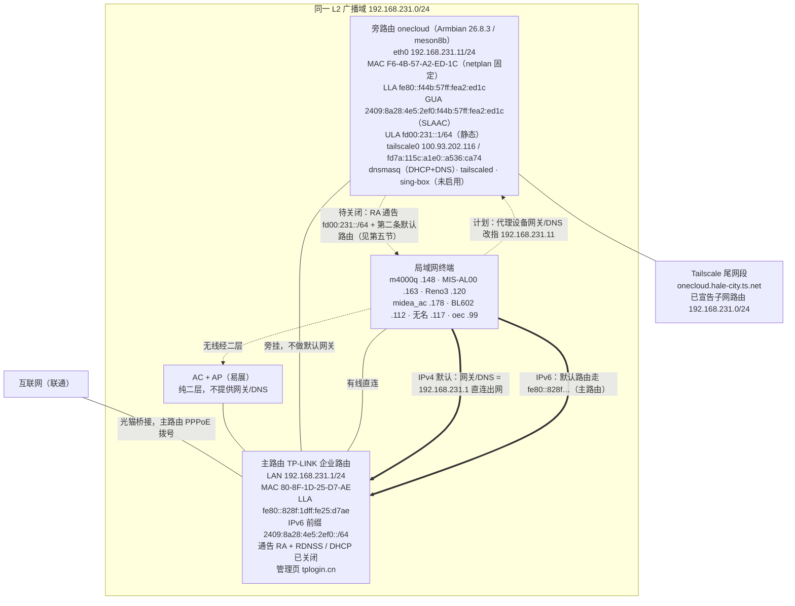

# 家庭网络架构（实测，2026-10-29）

## 一、架构图

路径要点：客户端 IPv4 与 IPv6 的正常出口都在主路由；旁路由只提供 DHCP/DNS/组网，需代理的设备由 dnsmasq 按 tag 改指 `192.168.231.11`。

## 二、主路由 TP-LINK（192.168.231.1）

| 项目 | 实测值 |
|---|---|
| 角色 | PPPoE 拨号、IPv4 默认网关、IPv6 唯一应当通告 RA 的设备 |
| LAN IPv4 | 192.168.231.1/24 |
| LAN MAC | 80-8F-1D-25-D7-AE |
| 链路本地 | fe80::828f:1dff:fe25:d7ae |
| 通告前缀 | 2409:8a28:4e5:2ef0::/64 [onlink,auto]，valid 86400 / pref 14400 |
| RDNSS | 2409:8a28:4e5:2ef0:828f:1dff:fe25:d7ae |
| 管理页 | http://tplogin.cn （旁路由 dnsmasq 有 `address=/tplogin.cn/192.168.231.1`） |

设置要点

- WAN：光猫桥接 + 主路由 PPPoE 拨号；IPv6 已拿到联通前缀，状态健康。
- DHCP 服务：关闭，由旁路由接管（旁路由 `dhcp-authoritative`，下发 `option 3/6 = 192.168.231.1`）。
- IPv6：保持"无状态/SLAAC + 主路由通告 RA"，当前实际通告的是 2409:8a28:4e5:2ef0::/64。
- 需要做的只有一件事：确认 IPv6 RA 只由它发（旁路由侧关掉 RA，见第五节）。

## 三、旁路由 onecloud（192.168.231.11）

| 项目 | 实测值 |
|---|---|
| 设备 | OneCloud（Amlogic meson8b，armv7l），Armbian 26.8.3 trixie，kernel 6.12.28-current-meson |
| 登录 | `ssh root@192.168.231.11`（`~/.ssh/config` 中别名 `tailscale`，key `~/.ssh/ed25519`） |
| eth0 IPv4 | 192.168.231.11/24 |
| eth0 MAC | f6:4b:57:a2:ed:1c（`/etc/netplan/20-eth-fixed-mac.yaml` 固定，因此 fe80 地址稳定） |
| eth0 IPv6 | GUA 2409:8a28:4e5:2ef0:f44b:57ff:fea2:ed1c/64（SLAAC，由 networkd 用户态收 RA，路由 `proto ra metric 1024`）；静态 ULA fd00:231::1/64；LLA fe80::f44b:57ff:fea2:ed1c |
| IPv6 学习 | `/etc/netplan/armbian.yaml`：`dhcp6: false`（不用 DHCPv6-PD），`eth0.accept_ra=0`（交给 systemd-networkd） |
| 转发 | `net.ipv4.ip_forward=1`，`net.ipv6.conf.all.forwarding=1`（`/etc/sysctl.d/99-tailscale.conf`） |
| 防火墙 | 只有 Tailscale 生成的持久化 ip(6)tables：`nat ts-postrouting` mark `0x40000/0xff0000` MASQUERADE、`filter ts-forward/ts-input`、`mangle` CONNMARK 恢复；FORWARD 策略 ACCEPT；无 nftables 规则集、无 sing-box redirect/tproxy 规则 |
| tailscale | v1.104.2，active/enabled，`onecloud.hale-city.ts.net`，AllowedIPs 含 `192.168.231.0/24`（子网路由已宣告），节点密钥到期 2027-04-26 |
| DHCP 池 | 192.168.231.101–200/255.255.255.0/12h，`dhcp-authoritative`，`domain=lan`、`expand-hosts`、`dhcp-fqdn` |
| 静态租约 | woniu 192.168.231.100（00:E2:69:13:C0:64）；oec 192.168.231.99（DA:43:B1:F8:F7:78） |
| DNS | :53，上游 223.5.5.5、119.29.29.29、2409:8028:2000::1111、2409:8028:2000::2222、100.100.100.100（尾网段，走 Tailscale）；`listen-address=192.168.231.11,127.0.0.1,100.93.202.116` |
| 下发给普通客户端 | `option 3 = 192.168.231.1`、`option 6 = 192.168.231.1`、`option 138 = 192.168.231.1`、`option 60 = TP-LINK`（即默认全部直连主路由） |
| 代理设备标记 | `tag:proxy_devices` → `option:router/dns-server = 192.168.231.11`；当前唯一绑定该 tag 的 `dhcp-host` 行是注释状态，集合为空 |
| IPv6 RA | 当前开启：`enable-ra`、`dhcp-range=::,constructor:eth0,ra-only,slaac,64,1d`、`dhcp-option=eth0,option6:dns-server,fd00:231::1` |
| 在册客户端 | m4000q .148 / MIS-AL00 .163 / OPPO-Reno3-Pro-5G .120 / midea_ac_1363 .178 / Bouffalolab_BL602 .112 / 无名 .117（68:77:24:8D:2D:BB）/ oec .99 |
| 其他服务 | sshd active；cron、rsyslog、netfilter-persistent、unattended-upgrades、wpa_supplicant、systemd-resolved/timesyncd、armbian-* 一组 enabled；knockd active（端口序列 51002,58004,54781 → `wakeonlan 00:E2:69:13:C0:64`）；NetworkManager 未安装 |

设置要点（目标态）

1. IPv6 不由旁路由通告，RA 与 RDNSS 全部交给主路由；关掉上面那 3 行 dnsmasq 配置即可（`ipv6-fix/onecloud-dnsmasq-ra.sh`）。
2. 只由 dnsmasq + sing-box 两个软件承担分流：dnsmasq 负责"哪些设备走旁路由"，sing-box 负责转发；IPv6 保持直连不进隧道（RA 无法按设备区分）。
3. LAN 内无 tailscale 客户端访问尾网段，需要 `ip_forward` + SNAT（现有 `ts-postrouting` 只对旁路由自身发起的流量生效，转发流量还需 `192.168.231.0/24 → tailscale0` 的 MASQUERADE）+ 管理面板开启 subnet routing。

## 四、旁路由已安装软件

| 软件 | 版本 | 安装方式 | 状态 | 位置 / 备注 |
|---|---|---|---|---|
| dnsmasq | 2.91-1+deb13u2 | apt | active / enabled | `/etc/dnsmasq.conf`，DHCP + DNS + 当前那份 RA |
| tailscale / tailscaled | 1.104.2（含 tailscale-archive-keyring 1.35.181） | apt（官方源） | active / enabled | `tailscale0` 100.93.202.116、fd7a:115c:a1e0::a536:ca74；`/etc/default/tailscaled` PORT=41641；MagicDNS 写 resolvconf 失败（interface-name 不匹配），以 `server=100.100.100.100` 补偿 |
| sing-box | 1.12.23（armhf deb，dpkg 状态 `hi` 已 hold） | apt/deb | inactive / disabled，从未运行 | `/usr/bin/sing-box`；unit `/usr/lib/systemd/system/sing-box.service`（User=sing-box，CAP_NET_ADMIN/RAW/NET_BIND_SERVICE/SYS_PTRACE，`-D /var/lib/sing-box -C /etc/sing-box`）；`/var/lib/sing-box` 尚不存在；`/etc/sing-box/config.json`（644，内含明文 shadowsocks PSK，启用前先 `chmod 600` 并轮换密钥）现有配置为 SS 服务端，`sing-box check` 在当前版本 FATAL（1.13 起移除 special outbounds、1.14 起移除旧 DNS servers 语法） |
| systemd-networkd + netplan | 随 Armbian | — | active / enabled | `/etc/netplan/armbian.yaml`、`/etc/netplan/20-eth-fixed-mac.yaml` |
| knockd | 0.8-2+b4 | apt | active / enabled | WoL 触发（woniu） |
| netfilter-persistent | 1.0.23 | apt | enabled | `/etc/iptables/rules.v4`、`rules.v6`，内容为 Tailscale 生成 |
| armbian-config / armbian-firmware / bsp-cli-onecloud | 26.8.x | Armbian 镜像 | — | 板级工具 |
| wireguard-tools | 1.0.20210914-3 | apt | — | tailscale 依赖 |
| tcpdump | 4.99.5 | apt | — | 诊断用 |

## 五、当前唯一确认的故障

旁路由用 `constructor:eth0` 生成 RA，把 netplan 里写死的 `fd00:231::/64` 连同第二条默认路由通告给全网段；Windows 客户端对相当一部分公网目标把源地址选成 `fd00:231::…`，ULA 在公网不可路由，TCP 100% 丢包。修法与验证见 `ipv6-fix/CHANGES.md`（改动 A），执行需确认。

## 六、待确认

1. 代理设备清单：哪些 MAC 需要打上 `set:proxy_devices`。
2. sing-box 隧道形态与 SS inbound 8080 是否保留。
3. LAN→尾网段是否必须打通（需要 SNAT）。
4. 改动 A 的执行时间。
5. `68:77:24:8D:2D:BB`（192.168.231.117，无主机名）是什么设备——它曾触发单播 RA。
